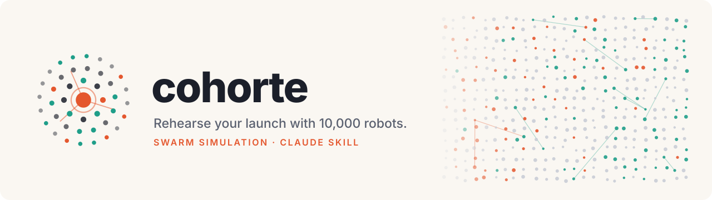
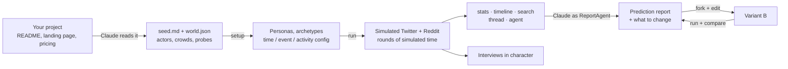

<div align="center">

<picture>
  <source media="(prefers-color-scheme: dark)" srcset="assets/brand/banner-dark.svg">
  <source media="(prefers-color-scheme: light)" srcset="assets/brand/banner-light.svg">
  
</picture>

<p>
  <a href="https://github.com/yeubridev/cohorte/actions/workflows/tests.yml"></a>
  
  
  
  
</p>

<p>
  <a href="#try-it-in-60-seconds-free-offline"><b>Quickstart</b></a> ·
  <a href="#install"><b>Install</b></a> ·
  <a href="#use-it"><b>Use cases</b></a> ·
  <a href="#real-output-10000-robots-react-to-a-launch"><b>Real output</b></a> ·
  <a href="#how-it-works"><b>How it works</b></a> ·
  <a href="#cost-and-speed"><b>Cost</b></a> ·
  <a href="#faq"><b>FAQ</b></a> ·
  <a href="ROADMAP.md"><b>Roadmap</b></a>
</p>

</div>

# Cohorte

**Rehearse your project's reception with a cohort of AI robots, then fix what they hate before real people see it.**

You're about to ship a launch post, a pricing change, a new feature or a policy. You can guess how people will
react, wait for the backlash, or **rehearse it first**. Cohorte is a Claude Code skill that recreates
[MiroFish](https://github.com/666ghj/MiroFish), the swarm-intelligence prediction engine. Claude reads your
project and builds a small world around it: target users, skeptics, media, creators, competitors and your own
company account. Then it lets **a dozen to 10,000+ persona "robots"** live on simulated Twitter- and Reddit-like
platforms for a few simulated days. They read their feeds, post, like, repost, quote, comment, follow, argue and
change their minds.

| You get | What it looks like |
|---|---|
| 🔮 **A prediction report** | What happened, which group reacted how and why, quoted word for word from the robots, plus a *What to change* table |
| 📊 **Metrics per segment** | Sentiment over time, your own probes ("how likely are you to try it this week? 0–10"), top posts, opinion shifts |
| 🎙️ **Interviews** | Ask any robot, in character, why it did what it did and what would change its mind |
| 🔁 **A/B re-tests** | Change the copy, price or policy and replay the *same* cohort, then compare |

## Test anything: apps, websites, videos, films, articles…

Cohorte rates **any subject** with a cohort that experiences it the way real people would. It lands on the page,
reads the article, watches the trailer, looks at the store listing or reads the pitch. You get a **potential score
(0–100)**, scores per audience segment, what works, what puts people off, verbatim verdicts, and a
**confidence index**.

```bash
C="python3 skills/cohorte/scripts/cohorte.py"
$C ingest https://example.com/landing trailer.srt deck.pdf --kind website --out drafts/x   # pages, PDF, DOCX, subtitles, images, video frames
$C init x --world world.json --seed drafts/x/seed.md --subject drafts/x/subject.json
$C setup x && $C assess x --runs 5 --models opus,sonnet
```

Kinds: `app`, `website`, `video`, `movie`, `series`, `article`, `book`, `music`, `game`, `product`, `pricing`,
`ad`, `pitch`, `job_offer`, `policy`, `event`, `generic`. Each has its own rating dimensions and the real-world
outcomes it is usually judged on.

**About the confidence index:** no simulation of people can promise ~100% on future events, and Cohorte doesn't
pretend to. The index combines four things:
- how stable the score is across runs and exposure contexts;
- how complete the material is;
- whether different models agree;
- how many people answered.

It is **capped at 60 until the subject kind is calibrated** on real outcomes. Each time you learn what really
happened (rating, conversion, retention…), run `calibrate add`. After 5 outcomes Cohorte gives calibrated
estimates in real units with an 80% interval. The cap rises toward 100 only as correlation with reality and the
number of outcomes grow. Details: [subjects and confidence](skills/cohorte/references/subjects-and-confidence.md).

**Real run:** the MiroFish README, assessed as a `website` by 3,000 developers, researchers and product people
(Haiku 5.5, 3 runs, $0.12):
- potential **43.9/100**, stable across runs (42.9–45.4);
- confidence **60/100 (moderate, capped: uncalibrated)**;
- top turn-off: "promises to predict anything… no accuracy figures, no backtests".

## Try it in 60 seconds (free, offline)

The `mock` backend runs the whole pipeline with fake answers, so you can see the mechanics before spending a cent:

```bash
git clone https://github.com/yeubridev/cohorte && cd cohorte
C="python3 skills/cohorte/scripts/cohorte.py"
$C init demo --world skills/cohorte/assets/world.example.json --backend mock
$C setup demo && $C run demo
$C stats demo && $C timeline demo
```

For real predictions, install the skill (below) and ask Claude in plain words. Claude frames the question, builds
the world from your repo, shows you the cast and the **cost estimate before anything runs**, simulates, writes the
report and helps you adapt.

## Install

**Claude Code plugin** (recommended):
```
/plugin marketplace add yeubridev/cohorte
/plugin install cohorte@cohorte
```

**Plain skill**: copy `skills/cohorte/` to `~/.claude/skills/cohorte/` (all projects) or
`<project>/.claude/skills/cohorte/` (one project). **claude.ai**: zip `skills/cohorte` and upload it as a skill
(needs code execution).

Python 3.9+, standard library only. Pick one LLM backend:

| Backend | Needs | Best for |
|---|---|---|
| `claude-cli` | the `claude` command (your Claude Code login) | no API key; fine up to ~10,000 agents for a few hours |
| `anthropic` | `pip install anthropic` + `ANTHROPIC_API_KEY` | fastest: parallel calls, prompt caching |
| `manual` | nothing | Claude answers each robot's prompt itself; tiny runs |
| `mock` | nothing | offline dry runs and tests |

`python3 skills/cohorte/scripts/cohorte.py doctor` tells you which backends work on your machine.

## Use it

Ask Claude inside your project:

- *"Use cohorte to test how freelance designers and agencies react to our launch post in `marketing/launch.md`."*
- *"We're moving from 9 € to 12 €/month for existing users. Which segments churn, and why?"*
- *"Run the same cohort on version B of the headline and compare."*
- *"Simulate 10,000 French parents and 2,000 privacy advocates reacting to the pricing page."*
- *"Interview the three most negative robots about what would change their mind."*

| Scenario | Typical cast | Probes / what-if events |
|---|---|---|
| 🚀 Product launch | target segments, skeptics, 2 media, creators, competitor, your company | try intent, price acceptance · competitor reply at 24 h |
| 💶 Pricing change | loyal, price-sensitive and power users, prospects, competitor | churn intent, fairness · your FAQ clarification |
| 📰 Landing page / message A/B | cold-audience crowds, a few experts | click or try intent · `fork` with variant copy |
| 🔒 Terms of service / feature removal | power users, moderators, privacy advocates, media | trust, churn · official apology post |
| 🧑‍💻 Open-source or developer tool launch | maintainers, enterprise devs, hobbyists, category skeptics | adoption, star intent |
| 🏢 Internal announcement | departments as crowds, managers, representatives | support, attrition risk |
| 📖 Story or ending | characters, fan communities | per-character probes |

## Real output: 10,000 robots react to a launch

This is the bundled fictional example: *Tandem*, an AI meal planner launching at 12 €/month with a 7-day trial
and a vague data-sharing clause. The run had 10,000 agents (13 with their own LLM turns and 9,987 crowd members)
and covered 3 simulated evening hours on Claude Haiku 5.5 through `claude -p`. It took **88 LLM calls,
2.5 minutes and $0.13**.

Claude designed the crowd archetypes. The table shows a few of them, with their latest mean answers:

| Archetype | Mood (−1…+1) | Try the trial (0–10) | Price OK (0–10) |
|---|---|---|---|
| Time-starved dual-income planner | **+0.34** | **5.7** | **6.3** |
| Single parent on a tight budget | −0.25 | 2.4 | 2.5 |
| Frugal two-parent household counting every euro | −0.37 | 2.5 | 3.2 |
| Privacy-minded tech-aware parent | −0.28 | 1.5 | 3.7 |
| Policy-reading privacy hardliner | −0.62 | 1.3 | 3.2 |

The crowd's comments under the launch post raised the same objections as the LLM agents, in many voices:

> "12 a month is 144 a year. is the trial card free or do they bill you on day 8?" — u/bruno_w5296
>
> "Snap your fridge means photos of your home interior. Where are they processed and for how long?" — u/leo_f4023
>
> "finally something for the 6pm what's for dinner panic 🍴 signing up today" — u/lea_b6228

In interviews, an LLM agent (a privacy consultant) listed seven conditions for trying it: a separate
opt-in for partner data sharing, a stated retention period, a working deletion path, and four more.

**What the report would tell Tandem:** the price is acceptable to time-starved households but not to budget ones,
the hidden auto-renewal and the undefined "partners" clause are the real blockers, and both can be fixed in the
copy. The next step is to `fork` the run with a rewritten launch post and `compare`.

## How it works



There are **two tiers of robots**:

- **LLM agents** are named actors, plus 3 delegates per crowd. Each has a full persona and makes its own LLM call
  every time it is online. They search, quote, reply, remember what happened and get notified when people react
  to them. These are the voices you interview.
- **Crowd members** fill big segments. Claude designs about 6 archetypes per segment, and members are sampled
  from them as individual agents with their own name, follows, feed, opinion, likes, comments and posts. Each
  round costs **one LLM call per segment**, not one per member. That call returns reaction probabilities and texts
  in each archetype's voice. Every member then samples its own actions: it likes authors it agrees with and
  downvotes the ones it doesn't, and its opinion drifts by its own susceptibility.

Each round also does the following:
- Agents come online by time of day and their own activity.
- Feeds rank posts by recency, popularity, relevance, follows, echo chamber and virality.
- God's-eye events, such as a competitor reply or a news leak, can be injected at any simulated hour.
- Every agent privately records a thought, a sentiment and your probe answers. The report uses these to explain
  *why* people behaved as they did.

## The adapt loop

```bash
C="python3 skills/cohorte/scripts/cohorte.py"
$C fork launch launch-v2 --posts v2_posts.json --replace-posts   # same robots, same schedule, new copy
$C run launch-v2
$C compare launch launch-v2      # sentiment, probes and actions side by side, per segment
```

Forks keep the exact same robots and random activation schedule, so differences come from your change (plus model
noise). Claude tells you which deltas are large enough to act on.

## Cost and speed

| Run | LLM calls | Cost |
|---|---|---|
| 10 agents × 4 simulated hours (Haiku 5.5, `claude -p`) | 67 | ≈ $0.06 |
| 10,000 agents × 3 simulated hours (Haiku 5.5, `claude -p`) | 88 | $0.13, 2.5 min |
| 10,000 agents × 24 simulated hours, estimate | ≈ 300 | Haiku 5.5 ≈ $0.35 · Opus 5.5 ≈ $14 |
| Same run with one LLM call per agent turn | ≈ 32,000 | Haiku ≈ $13 · Opus ≈ $520 |

- `estimate` gives the exact number of agent turns before you run, because activation is seeded.
- Runs are resumable: every round is saved and LLM answers are cached, so a crash never costs twice.
- The engine handles 10,000 agents in about 1 s per simulated round. The rest of the time is LLM calls.

## Command cheat sheet

| Stage | Commands |
|---|---|
| Build | `doctor` · `validate world.json` · `init` · `setup` · `show [--full]` · `estimate [--model haiku]` |
| Simulate | `run [--max-rounds N]` · `inject --at-hour 30 --content "…"` · `status` |
| Observe | `stats` · `timeline [--bucket 6]` · `search <words> [--thoughts]` · `thread <post>` · `agent <id or @name>` · `export` |
| Rate | `ingest <urls/files> --kind K --out DIR` · `kinds` · `assess [--runs 5] [--models a,b]` · `calibrate add\|fit\|show` |
| Talk | `interview -q "…" (--agents … \| --type T --sample N) [--followup]` |
| Adapt | `fork` · `compare` · `llm --backend … --model …` |

## FAQ

**Are the predictions accurate?** They're a rehearsal, not a measurement. LLM robots are articulate, more
reasonable and more alike than real crowds, and they only know what the seed says. They're good at surfacing
objections, comparing variants and preparing answers before real users and press do it for you. For big decisions,
validate with real people.

**Which model should I use?** The engine defaults to Claude Opus 5.5. Claude Haiku 5.5 is around 40× cheaper and
works well for crowds. The skill shows both estimates and lets you choose.

**Does it work in other languages?** Yes: set `"language": "French"` (or any other language) and the robots post
in it.

**What leaves my machine?** The seed and personas are sent to the model provider you choose. Leave secrets out.

**Can I use real people or brands?** Prefer archetypes and fictional individuals. Real organisations can appear,
but their simulated statements must never be presented as real.

## Repository layout

```
skills/cohorte/
├── SKILL.md                 # what Claude follows: frame → world → setup → run → report → interview → adapt
├── scripts/cohorte.py       # CLI engine (stdlib only)
├── scripts/cohorte_engine/  # world, personas, platforms, crowd tier, simulation, analysis, LLM backends
├── references/              # world-building guide, report method, engine reference
└── assets/world.example.json
assets/brand/                # logo, banners, social preview (+ generator)
tests/                       # offline tests (mock and manual backends, 6,000-agent crowd test)
```

## How it maps to MiroFish

| MiroFish | Cohorte |
|---|---|
| Ontology + Zep GraphRAG from seed documents | Claude writes `world.json` (same ontology rules: speaking actors only, ~10 types with `Person`/`Organization` fallbacks) and `seed.md` |
| OASIS profile generator | `setup`: same persona structure, plus crowd archetypes |
| Simulation config generator (time, events, activity) | `setup`: same fields, guards and kick-off post assignment |
| OASIS Twitter + Reddit, time-of-day activation | `run`: same action sets, feed ranking, notifications, memory, seeded activation |
| ReportAgent (insight_forge, panorama_search, quick_search, interview_agents) | Claude with `stats`, `timeline`, `search`, `thread`, `agent`, `interview` |
| Chat with any agent | `interview [--followup]` |
| – | crowd tier for 10,000+ agents, private thoughts and probes, `inject`, `fork` + `compare` |

Details: [`skills/cohorte/references/engine.md`](skills/cohorte/references/engine.md).

## Brand

The logo is a ring of robots around one voice: grey for indifferent, teal for positive and coral for negative.
The files are in [`assets/brand/`](assets/brand): light and dark banners and logos, plus `social-preview.png` for
the repository's social preview. Regenerate them with `python3 assets/brand/generate.py assets/brand`.

## Development

```bash
python3 -m unittest discover -s tests      # offline, mock + manual backends
claude plugin validate .                   # marketplace + plugin manifests
```

## Credits and license

Cohorte re-implements the pipeline of [MiroFish](https://github.com/666ghj/MiroFish) (AGPL-3.0), whose simulation
layer is [OASIS](https://github.com/camel-ai/oasis) by CAMEL-AI (Apache-2.0). Its prompts and several algorithms
(persona fields, configuration heuristics, agent activation, report method) are adapted from MiroFish. Keep this
in mind when choosing a license for this repository.
